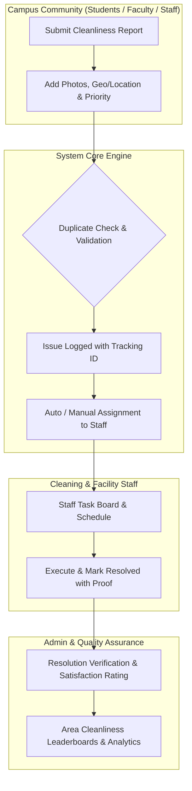

# Campus Cleanliness Management System — Feature List

> **Project**: [Campus Cleanliness System (Project #2)](https://github.com/users/muntaha-ux/projects/2/views/1)  
> **View**: [View 1: Backlog Board](https://github.com/users/muntaha-ux/projects/2/views/1)  
> **Repository**: [muntaha-ux/Campus-cleanliness-management-system](https://github.com/muntaha-ux/Campus-cleanliness-management-system)  
> **Total Features Tracked**: 87 Items  

## Executive Summary

The **Campus Cleanliness Management System** is a complete, role-based platform designed to maintain and improve hygiene, waste management, and facility sanitation across campus grounds, buildings, and specialized facilities. It provides full lifecycle tracking from issue detection and anonymous or verified reporting, to automated staff dispatch, multi-tier status workflows, real-time analytics, and student/staff satisfaction loops.

---

## Feature Modules Overview

| Module | Feature Range | Item Count | Key Capabilities |
| :--- | :---: | :---: | :--- |
| **1. Authentication & Profiles** | #1-#2, #8-#17 | 12 | Registration, role-based access (Student/Teacher/Admin), email verification, password reset, profile images |
| **2. Issue Reporting & Submission** | #3-#7, #18-#37 | 25 | Photo upload, multi-tier location (Building/Floor/Room/Area), priority flags, emergency & anonymous reports, duplicate detection, status tracking |
| **3. Staff & Task Assignment** | #38-#47 | 10 | Auto/manual assignment, department routing, staff workloads, shift availability, task & schedule management |
| **4. Dashboards & Live Counters** | #48-#57 | 10 | Role-specific dashboards (Admin, Student, Teacher, Staff), real-time counters (Pending, Resolved, Overdue), activity feeds |
| **5. Notification System** | #58-#67 | 10 | In-app alerts, email notifications, assignment & status updates, broadcast announcements, notification preferences |
| **6. Search, Filtering & Sorting** | #68-#75 | 8 | Full-text issue search, multi-parameter filtering (category, location, status, priority, date), multi-column sorting |
| **7. Analytics, Verification & Ratings** | #76-#87 | 12 | Resolution verification, student/staff ratings, reopen requests, area cleanliness scores, leaderboard, monthly reports, system audit logs |

---

## Authentication & User Management

Comprehensive identity management supporting fine-grained Role-Based Access Control (RBAC) across Students, Faculty/Teachers, Cleaning Staff, and System Administrators, complete with security and credential recovery flows.

| # | Title | Project Status | Issue Link | Description / Scope |
| :---: | :--- | :---: | :---: | :--- |
| `#1` | **User Registration and Login** | `Backlog` | [View #1](https://github.com/muntaha-ux/Campus-cleanliness-management-system/issues/1) | Initial project specification item (superseded/expanded in standardized set). |
| `#2` | **Student or Teacher or Admin Profiles** | `Backlog` | [View #2](https://github.com/muntaha-ux/Campus-cleanliness-management-system/issues/2) | Initial project specification item (superseded/expanded in standardized set). |
| `#8` | **User Registration and Login** | `Backlog` | [View #8](https://github.com/muntaha-ux/Campus-cleanliness-management-system/issues/8) | Implement the User Registration and Login feature for the Campus Cleanliness System. |
| `#9` | **Student Profile Management** | `Backlog` | [View #9](https://github.com/muntaha-ux/Campus-cleanliness-management-system/issues/9) | Implement the Student Profile Management feature for the Campus Cleanliness System. |
| `#10` | **Teacher Profile Management** | `Backlog` | [View #10](https://github.com/muntaha-ux/Campus-cleanliness-management-system/issues/10) | Implement the Teacher Profile Management feature for the Campus Cleanliness System. |
| `#11` | **Admin Profile Management** | `Backlog` | [View #11](https://github.com/muntaha-ux/Campus-cleanliness-management-system/issues/11) | Implement the Admin Profile Management feature for the Campus Cleanliness System. |
| `#12` | **Role Based Access Control** | `Backlog` | [View #12](https://github.com/muntaha-ux/Campus-cleanliness-management-system/issues/12) | Implement the Role Based Access Control feature for the Campus Cleanliness System. |
| `#13` | **Secure Password Management** | `Backlog` | [View #13](https://github.com/muntaha-ux/Campus-cleanliness-management-system/issues/13) | Implement the Secure Password Management feature for the Campus Cleanliness System. |
| `#14` | **Email Verification** | `Backlog` | [View #14](https://github.com/muntaha-ux/Campus-cleanliness-management-system/issues/14) | Implement the Email Verification feature for the Campus Cleanliness System. |
| `#15` | **Forgot Password and Reset** | `Backlog` | [View #15](https://github.com/muntaha-ux/Campus-cleanliness-management-system/issues/15) | Implement the Forgot Password and Reset feature for the Campus Cleanliness System. |
| `#16` | **User Account Activation and Deactivation** | `Backlog` | [View #16](https://github.com/muntaha-ux/Campus-cleanliness-management-system/issues/16) | Implement the User Account Activation and Deactivation feature for the Campus Cleanliness System. |
| `#17` | **User Profile Photo** | `Backlog` | [View #17](https://github.com/muntaha-ux/Campus-cleanliness-management-system/issues/17) | Implement the User Profile Photo feature for the Campus Cleanliness System. |

## Issue Reporting & Submission

The primary intake engine allowing campus users to quickly lodge cleanliness issues with rich media attachments, multi-level spatial granularity, emergency triggers, and anonymous reporting.

| # | Title | Project Status | Issue Link | Description / Scope |
| :---: | :--- | :---: | :---: | :--- |
| `#3` | **Report Cleanliness Issue** | `Backlog` | [View #3](https://github.com/muntaha-ux/Campus-cleanliness-management-system/issues/3) | Initial project specification item (superseded/expanded in standardized set). |
| `#4` | **Issue Description** | `Backlog` | [View #4](https://github.com/muntaha-ux/Campus-cleanliness-management-system/issues/4) | Initial project specification item (superseded/expanded in standardized set). |
| `#5` | **Issue Categories** | `Backlog` | [View #5](https://github.com/muntaha-ux/Campus-cleanliness-management-system/issues/5) | Initial project specification item (superseded/expanded in standardized set). |
| `#6` | **Photo Upload** | `Backlog` | [View #6](https://github.com/muntaha-ux/Campus-cleanliness-management-system/issues/6) | Initial project specification item (superseded/expanded in standardized set). |
| `#7` | **Location Selection** | `Backlog` | [View #7](https://github.com/muntaha-ux/Campus-cleanliness-management-system/issues/7) | Initial project specification item (superseded/expanded in standardized set). |
| `#18` | **Cleanliness Issue Reporting** | `Backlog` | [View #18](https://github.com/muntaha-ux/Campus-cleanliness-management-system/issues/18) | Implement the Cleanliness Issue Reporting feature for the Campus Cleanliness System. |
| `#19` | **Issue Description** | `Backlog` | [View #19](https://github.com/muntaha-ux/Campus-cleanliness-management-system/issues/19) | Implement the Issue Description feature for the Campus Cleanliness System. |
| `#20` | **Issue Categories** | `Backlog` | [View #20](https://github.com/muntaha-ux/Campus-cleanliness-management-system/issues/20) | Implement the Issue Categories feature for the Campus Cleanliness System. |
| `#21` | **Photo Upload** | `Backlog` | [View #21](https://github.com/muntaha-ux/Campus-cleanliness-management-system/issues/21) | Implement the Photo Upload feature for the Campus Cleanliness System. |
| `#22` | **Multiple Photo Upload** | `Backlog` | [View #22](https://github.com/muntaha-ux/Campus-cleanliness-management-system/issues/22) | Implement the Multiple Photo Upload feature for the Campus Cleanliness System. |
| `#23` | **Location Based Reporting** | `Backlog` | [View #23](https://github.com/muntaha-ux/Campus-cleanliness-management-system/issues/23) | Implement the Location Based Reporting feature for the Campus Cleanliness System. |
| `#24` | **Building Selection** | `Backlog` | [View #24](https://github.com/muntaha-ux/Campus-cleanliness-management-system/issues/24) | Implement the Building Selection feature for the Campus Cleanliness System. |
| `#25` | **Floor Selection** | `Backlog` | [View #25](https://github.com/muntaha-ux/Campus-cleanliness-management-system/issues/25) | Implement the Floor Selection feature for the Campus Cleanliness System. |
| `#26` | **Room Selection** | `Backlog` | [View #26](https://github.com/muntaha-ux/Campus-cleanliness-management-system/issues/26) | Implement the Room Selection feature for the Campus Cleanliness System. |
| `#27` | **Specific Area Selection** | `Backlog` | [View #27](https://github.com/muntaha-ux/Campus-cleanliness-management-system/issues/27) | Implement the Specific Area Selection feature for the Campus Cleanliness System. |
| `#28` | **Issue Priority Selection** | `Backlog` | [View #28](https://github.com/muntaha-ux/Campus-cleanliness-management-system/issues/28) | Implement the Issue Priority Selection feature for the Campus Cleanliness System. |
| `#29` | **Emergency Cleanliness Report** | `Backlog` | [View #29](https://github.com/muntaha-ux/Campus-cleanliness-management-system/issues/29) | Implement the Emergency Cleanliness Report feature for the Campus Cleanliness System. |
| `#30` | **Anonymous Issue Reporting** | `Backlog` | [View #30](https://github.com/muntaha-ux/Campus-cleanliness-management-system/issues/30) | Implement the Anonymous Issue Reporting feature for the Campus Cleanliness System. |
| `#31` | **Duplicate Issue Detection** | `Backlog` | [View #31](https://github.com/muntaha-ux/Campus-cleanliness-management-system/issues/31) | Implement the Duplicate Issue Detection feature for the Campus Cleanliness System. |
| `#32` | **Issue Reference Number** | `Backlog` | [View #32](https://github.com/muntaha-ux/Campus-cleanliness-management-system/issues/32) | Implement the Issue Reference Number feature for the Campus Cleanliness System. |
| `#33` | **Issue Submission Timestamp** | `Backlog` | [View #33](https://github.com/muntaha-ux/Campus-cleanliness-management-system/issues/33) | Implement the Issue Submission Timestamp feature for the Campus Cleanliness System. |
| `#34` | **Issue Status Tracking** | `Backlog` | [View #34](https://github.com/muntaha-ux/Campus-cleanliness-management-system/issues/34) | Implement the Issue Status Tracking feature for the Campus Cleanliness System. |
| `#35` | **Issue History** | `Backlog` | [View #35](https://github.com/muntaha-ux/Campus-cleanliness-management-system/issues/35) | Implement the Issue History feature for the Campus Cleanliness System. |
| `#36` | **Issue Editing** | `Backlog` | [View #36](https://github.com/muntaha-ux/Campus-cleanliness-management-system/issues/36) | Implement the Issue Editing feature for the Campus Cleanliness System. |
| `#37` | **Issue Cancellation** | `Backlog` | [View #37](https://github.com/muntaha-ux/Campus-cleanliness-management-system/issues/37) | Implement the Issue Cancellation feature for the Campus Cleanliness System. |

## Staff & Task Assignment

Operational workflow and dispatch engine that balances workload among campus cleaning personnel, manages shifts, and automates task delegation based on zone and issue type.

| # | Title | Project Status | Issue Link | Description / Scope |
| :---: | :--- | :---: | :---: | :--- |
| `#38` | **Complaint Assignment** | `Backlog` | [View #38](https://github.com/muntaha-ux/Campus-cleanliness-management-system/issues/38) | Implement the Complaint Assignment feature for the Campus Cleanliness System. |
| `#39` | **Cleaning Staff Assignment** | `Backlog` | [View #39](https://github.com/muntaha-ux/Campus-cleanliness-management-system/issues/39) | Implement the Cleaning Staff Assignment feature for the Campus Cleanliness System. |
| `#40` | **Department Assignment** | `Backlog` | [View #40](https://github.com/muntaha-ux/Campus-cleanliness-management-system/issues/40) | Implement the Department Assignment feature for the Campus Cleanliness System. |
| `#41` | **Automatic Issue Assignment** | `Backlog` | [View #41](https://github.com/muntaha-ux/Campus-cleanliness-management-system/issues/41) | Implement the Automatic Issue Assignment feature for the Campus Cleanliness System. |
| `#42` | **Manual Issue Assignment** | `Backlog` | [View #42](https://github.com/muntaha-ux/Campus-cleanliness-management-system/issues/42) | Implement the Manual Issue Assignment feature for the Campus Cleanliness System. |
| `#43` | **Cleaning Staff Profile** | `Backlog` | [View #43](https://github.com/muntaha-ux/Campus-cleanliness-management-system/issues/43) | Implement the Cleaning Staff Profile feature for the Campus Cleanliness System. |
| `#44` | **Cleaning Staff Availability** | `Backlog` | [View #44](https://github.com/muntaha-ux/Campus-cleanliness-management-system/issues/44) | Implement the Cleaning Staff Availability feature for the Campus Cleanliness System. |
| `#45` | **Cleaning Staff Workload** | `Backlog` | [View #45](https://github.com/muntaha-ux/Campus-cleanliness-management-system/issues/45) | Implement the Cleaning Staff Workload feature for the Campus Cleanliness System. |
| `#46` | **Cleaning Task Management** | `Backlog` | [View #46](https://github.com/muntaha-ux/Campus-cleanliness-management-system/issues/46) | Implement the Cleaning Task Management feature for the Campus Cleanliness System. |
| `#47` | **Cleaning Schedule Management** | `Backlog` | [View #47](https://github.com/muntaha-ux/Campus-cleanliness-management-system/issues/47) | Implement the Cleaning Schedule Management feature for the Campus Cleanliness System. |

## Dashboards & Monitoring

Tailored command centers providing each stakeholder role with relevant real-time operational indicators, KPI summaries, and live status counters.

| # | Title | Project Status | Issue Link | Description / Scope |
| :---: | :--- | :---: | :---: | :--- |
| `#48` | **Admin Dashboard** | `Backlog` | [View #48](https://github.com/muntaha-ux/Campus-cleanliness-management-system/issues/48) | Implement the Admin Dashboard feature for the Campus Cleanliness System. |
| `#49` | **Student Dashboard** | `Backlog` | [View #49](https://github.com/muntaha-ux/Campus-cleanliness-management-system/issues/49) | Implement the Student Dashboard feature for the Campus Cleanliness System. |
| `#50` | **Teacher Dashboard** | `Backlog` | [View #50](https://github.com/muntaha-ux/Campus-cleanliness-management-system/issues/50) | Implement the Teacher Dashboard feature for the Campus Cleanliness System. |
| `#51` | **Cleaning Staff Dashboard** | `Backlog` | [View #51](https://github.com/muntaha-ux/Campus-cleanliness-management-system/issues/51) | Implement the Cleaning Staff Dashboard feature for the Campus Cleanliness System. |
| `#52` | **Issue Statistics Dashboard** | `Backlog` | [View #52](https://github.com/muntaha-ux/Campus-cleanliness-management-system/issues/52) | Implement the Issue Statistics Dashboard feature for the Campus Cleanliness System. |
| `#53` | **Real Time Issue Counter** | `Backlog` | [View #53](https://github.com/muntaha-ux/Campus-cleanliness-management-system/issues/53) | Implement the Real Time Issue Counter feature for the Campus Cleanliness System. |
| `#54` | **Pending Issue Counter** | `Backlog` | [View #54](https://github.com/muntaha-ux/Campus-cleanliness-management-system/issues/54) | Implement the Pending Issue Counter feature for the Campus Cleanliness System. |
| `#55` | **Resolved Issue Counter** | `Backlog` | [View #55](https://github.com/muntaha-ux/Campus-cleanliness-management-system/issues/55) | Implement the Resolved Issue Counter feature for the Campus Cleanliness System. |
| `#56` | **Overdue Issue Counter** | `Backlog` | [View #56](https://github.com/muntaha-ux/Campus-cleanliness-management-system/issues/56) | Implement the Overdue Issue Counter feature for the Campus Cleanliness System. |
| `#57` | **Dashboard Activity Summary** | `Backlog` | [View #57](https://github.com/muntaha-ux/Campus-cleanliness-management-system/issues/57) | Implement the Dashboard Activity Summary feature for the Campus Cleanliness System. |

## Notification System

Multi-channel notification infrastructure ensuring all stakeholders are promptly notified of status transitions, urgent assignments, and campus-wide announcements.

| # | Title | Project Status | Issue Link | Description / Scope |
| :---: | :--- | :---: | :---: | :--- |
| `#58` | **Notification System** | `Backlog` | [View #58](https://github.com/muntaha-ux/Campus-cleanliness-management-system/issues/58) | Implement the Notification System feature for the Campus Cleanliness System. |
| `#59` | **Complaint Status Notification** | `Backlog` | [View #59](https://github.com/muntaha-ux/Campus-cleanliness-management-system/issues/59) | Implement the Complaint Status Notification feature for the Campus Cleanliness System. |
| `#60` | **New Issue Notification** | `Backlog` | [View #60](https://github.com/muntaha-ux/Campus-cleanliness-management-system/issues/60) | Implement the New Issue Notification feature for the Campus Cleanliness System. |
| `#61` | **Assignment Notification** | `Backlog` | [View #61](https://github.com/muntaha-ux/Campus-cleanliness-management-system/issues/61) | Implement the Assignment Notification feature for the Campus Cleanliness System. |
| `#62` | **Resolution Notification** | `Backlog` | [View #62](https://github.com/muntaha-ux/Campus-cleanliness-management-system/issues/62) | Implement the Resolution Notification feature for the Campus Cleanliness System. |
| `#63` | **Announcement Notification** | `Backlog` | [View #63](https://github.com/muntaha-ux/Campus-cleanliness-management-system/issues/63) | Implement the Announcement Notification feature for the Campus Cleanliness System. |
| `#64` | **Email Notification** | `Backlog` | [View #64](https://github.com/muntaha-ux/Campus-cleanliness-management-system/issues/64) | Implement the Email Notification feature for the Campus Cleanliness System. |
| `#65` | **In App Notification** | `Backlog` | [View #65](https://github.com/muntaha-ux/Campus-cleanliness-management-system/issues/65) | Implement the In App Notification feature for the Campus Cleanliness System. |
| `#66` | **Notification History** | `Backlog` | [View #66](https://github.com/muntaha-ux/Campus-cleanliness-management-system/issues/66) | Implement the Notification History feature for the Campus Cleanliness System. |
| `#67` | **Notification Preferences** | `Backlog` | [View #67](https://github.com/muntaha-ux/Campus-cleanliness-management-system/issues/67) | Implement the Notification Preferences feature for the Campus Cleanliness System. |

## Search, Filtering & Sorting

High-performance exploration tools enabling users and administrators to slice, query, and locate historical and active issues across multiple dimensions.

| # | Title | Project Status | Issue Link | Description / Scope |
| :---: | :--- | :---: | :---: | :--- |
| `#68` | **Issue Search** | `Backlog` | [View #68](https://github.com/muntaha-ux/Campus-cleanliness-management-system/issues/68) | Implement the Issue Search feature for the Campus Cleanliness System. |
| `#69` | **Advanced Issue Filtering** | `Backlog` | [View #69](https://github.com/muntaha-ux/Campus-cleanliness-management-system/issues/69) | Implement the Advanced Issue Filtering feature for the Campus Cleanliness System. |
| `#70` | **Filter by Category** | `Backlog` | [View #70](https://github.com/muntaha-ux/Campus-cleanliness-management-system/issues/70) | Implement the Filter by Category feature for the Campus Cleanliness System. |
| `#71` | **Filter by Location** | `Backlog` | [View #71](https://github.com/muntaha-ux/Campus-cleanliness-management-system/issues/71) | Implement the Filter by Location feature for the Campus Cleanliness System. |
| `#72` | **Filter by Status** | `Backlog` | [View #72](https://github.com/muntaha-ux/Campus-cleanliness-management-system/issues/72) | Implement the Filter by Status feature for the Campus Cleanliness System. |
| `#73` | **Filter by Priority** | `Backlog` | [View #73](https://github.com/muntaha-ux/Campus-cleanliness-management-system/issues/73) | Implement the Filter by Priority feature for the Campus Cleanliness System. |
| `#74` | **Filter by Date** | `Backlog` | [View #74](https://github.com/muntaha-ux/Campus-cleanliness-management-system/issues/74) | Implement the Filter by Date feature for the Campus Cleanliness System. |
| `#75` | **Sort Issues** | `Backlog` | [View #75](https://github.com/muntaha-ux/Campus-cleanliness-management-system/issues/75) | Implement the Sort Issues feature for the Campus Cleanliness System. |

## Analytics, Verification & Ratings

Closed-loop quality assurance framework featuring post-resolution validation, citizen feedback, quantitative cleanliness indices, and gamified campus leaderboards.

| # | Title | Project Status | Issue Link | Description / Scope |
| :---: | :--- | :---: | :---: | :--- |
| `#76` | **Issue Analytics** | `Backlog` | [View #76](https://github.com/muntaha-ux/Campus-cleanliness-management-system/issues/76) | Implement the Issue Analytics feature for the Campus Cleanliness System. |
| `#77` | **Cleanliness Performance Report** | `Backlog` | [View #77](https://github.com/muntaha-ux/Campus-cleanliness-management-system/issues/77) | Implement the Cleanliness Performance Report feature for the Campus Cleanliness System. |
| `#78` | **Resolved Issue Verification** | `Backlog` | [View #78](https://github.com/muntaha-ux/Campus-cleanliness-management-system/issues/78) | Implement the Resolved Issue Verification feature for the Campus Cleanliness System. |
| `#79` | **Student Satisfaction Rating** | `Backlog` | [View #79](https://github.com/muntaha-ux/Campus-cleanliness-management-system/issues/79) | Implement the Student Satisfaction Rating feature for the Campus Cleanliness System. |
| `#80` | **Cleaning Staff Rating** | `Backlog` | [View #80](https://github.com/muntaha-ux/Campus-cleanliness-management-system/issues/80) | Implement the Cleaning Staff Rating feature for the Campus Cleanliness System. |
| `#81` | **Issue Reopen Request** | `Backlog` | [View #81](https://github.com/muntaha-ux/Campus-cleanliness-management-system/issues/81) | Implement the Issue Reopen Request feature for the Campus Cleanliness System. |
| `#82` | **Admin Feedback Management** | `Backlog` | [View #82](https://github.com/muntaha-ux/Campus-cleanliness-management-system/issues/82) | Implement the Admin Feedback Management feature for the Campus Cleanliness System. |
| `#83` | **Cleanliness Score** | `Backlog` | [View #83](https://github.com/muntaha-ux/Campus-cleanliness-management-system/issues/83) | Implement the Cleanliness Score feature for the Campus Cleanliness System. |
| `#84` | **Area Cleanliness Ranking** | `Backlog` | [View #84](https://github.com/muntaha-ux/Campus-cleanliness-management-system/issues/84) | Implement the Area Cleanliness Ranking feature for the Campus Cleanliness System. |
| `#85` | **Campus Cleanliness Leaderboard** | `Backlog` | [View #85](https://github.com/muntaha-ux/Campus-cleanliness-management-system/issues/85) | Implement the Campus Cleanliness Leaderboard feature for the Campus Cleanliness System. |
| `#86` | **Monthly Cleanliness Report** | `Backlog` | [View #86](https://github.com/muntaha-ux/Campus-cleanliness-management-system/issues/86) | Implement the Monthly Cleanliness Report feature for the Campus Cleanliness System. |
| `#87` | **System Activity Log** | `Backlog` | [View #87](https://github.com/muntaha-ux/Campus-cleanliness-management-system/issues/87) | Implement the System Activity Log feature for the Campus Cleanliness System. |

---

## Master Item Index (All 87 Items)

| Item # | GitHub Issue | Title | Category / Module | Status in View 1 |
| :---: | :---: | :--- | :--- | :---: |
| 1 | [#1](https://github.com/muntaha-ux/Campus-cleanliness-management-system/issues/1) | User Registration and Login | Authentication & User Management | `Backlog` |
| 2 | [#2](https://github.com/muntaha-ux/Campus-cleanliness-management-system/issues/2) | Student or Teacher or Admin Profiles | Authentication & User Management | `Backlog` |
| 3 | [#3](https://github.com/muntaha-ux/Campus-cleanliness-management-system/issues/3) | Report Cleanliness Issue | Issue Reporting & Submission | `Backlog` |
| 4 | [#4](https://github.com/muntaha-ux/Campus-cleanliness-management-system/issues/4) | Issue Description | Issue Reporting & Submission | `Backlog` |
| 5 | [#5](https://github.com/muntaha-ux/Campus-cleanliness-management-system/issues/5) | Issue Categories | Issue Reporting & Submission | `Backlog` |
| 6 | [#6](https://github.com/muntaha-ux/Campus-cleanliness-management-system/issues/6) | Photo Upload | Issue Reporting & Submission | `Backlog` |
| 7 | [#7](https://github.com/muntaha-ux/Campus-cleanliness-management-system/issues/7) | Location Selection | Issue Reporting & Submission | `Backlog` |
| 8 | [#8](https://github.com/muntaha-ux/Campus-cleanliness-management-system/issues/8) | User Registration and Login | Authentication & User Management | `Backlog` |
| 9 | [#9](https://github.com/muntaha-ux/Campus-cleanliness-management-system/issues/9) | Student Profile Management | Authentication & User Management | `Backlog` |
| 10 | [#10](https://github.com/muntaha-ux/Campus-cleanliness-management-system/issues/10) | Teacher Profile Management | Authentication & User Management | `Backlog` |
| 11 | [#11](https://github.com/muntaha-ux/Campus-cleanliness-management-system/issues/11) | Admin Profile Management | Authentication & User Management | `Backlog` |
| 12 | [#12](https://github.com/muntaha-ux/Campus-cleanliness-management-system/issues/12) | Role Based Access Control | Authentication & User Management | `Backlog` |
| 13 | [#13](https://github.com/muntaha-ux/Campus-cleanliness-management-system/issues/13) | Secure Password Management | Authentication & User Management | `Backlog` |
| 14 | [#14](https://github.com/muntaha-ux/Campus-cleanliness-management-system/issues/14) | Email Verification | Authentication & User Management | `Backlog` |
| 15 | [#15](https://github.com/muntaha-ux/Campus-cleanliness-management-system/issues/15) | Forgot Password and Reset | Authentication & User Management | `Backlog` |
| 16 | [#16](https://github.com/muntaha-ux/Campus-cleanliness-management-system/issues/16) | User Account Activation and Deactivation | Authentication & User Management | `Backlog` |
| 17 | [#17](https://github.com/muntaha-ux/Campus-cleanliness-management-system/issues/17) | User Profile Photo | Authentication & User Management | `Backlog` |
| 18 | [#18](https://github.com/muntaha-ux/Campus-cleanliness-management-system/issues/18) | Cleanliness Issue Reporting | Issue Reporting & Submission | `Backlog` |
| 19 | [#19](https://github.com/muntaha-ux/Campus-cleanliness-management-system/issues/19) | Issue Description | Issue Reporting & Submission | `Backlog` |
| 20 | [#20](https://github.com/muntaha-ux/Campus-cleanliness-management-system/issues/20) | Issue Categories | Issue Reporting & Submission | `Backlog` |
| 21 | [#21](https://github.com/muntaha-ux/Campus-cleanliness-management-system/issues/21) | Photo Upload | Issue Reporting & Submission | `Backlog` |
| 22 | [#22](https://github.com/muntaha-ux/Campus-cleanliness-management-system/issues/22) | Multiple Photo Upload | Issue Reporting & Submission | `Backlog` |
| 23 | [#23](https://github.com/muntaha-ux/Campus-cleanliness-management-system/issues/23) | Location Based Reporting | Issue Reporting & Submission | `Backlog` |
| 24 | [#24](https://github.com/muntaha-ux/Campus-cleanliness-management-system/issues/24) | Building Selection | Issue Reporting & Submission | `Backlog` |
| 25 | [#25](https://github.com/muntaha-ux/Campus-cleanliness-management-system/issues/25) | Floor Selection | Issue Reporting & Submission | `Backlog` |
| 26 | [#26](https://github.com/muntaha-ux/Campus-cleanliness-management-system/issues/26) | Room Selection | Issue Reporting & Submission | `Backlog` |
| 27 | [#27](https://github.com/muntaha-ux/Campus-cleanliness-management-system/issues/27) | Specific Area Selection | Issue Reporting & Submission | `Backlog` |
| 28 | [#28](https://github.com/muntaha-ux/Campus-cleanliness-management-system/issues/28) | Issue Priority Selection | Issue Reporting & Submission | `Backlog` |
| 29 | [#29](https://github.com/muntaha-ux/Campus-cleanliness-management-system/issues/29) | Emergency Cleanliness Report | Issue Reporting & Submission | `Backlog` |
| 30 | [#30](https://github.com/muntaha-ux/Campus-cleanliness-management-system/issues/30) | Anonymous Issue Reporting | Issue Reporting & Submission | `Backlog` |
| 31 | [#31](https://github.com/muntaha-ux/Campus-cleanliness-management-system/issues/31) | Duplicate Issue Detection | Issue Reporting & Submission | `Backlog` |
| 32 | [#32](https://github.com/muntaha-ux/Campus-cleanliness-management-system/issues/32) | Issue Reference Number | Issue Reporting & Submission | `Backlog` |
| 33 | [#33](https://github.com/muntaha-ux/Campus-cleanliness-management-system/issues/33) | Issue Submission Timestamp | Issue Reporting & Submission | `Backlog` |
| 34 | [#34](https://github.com/muntaha-ux/Campus-cleanliness-management-system/issues/34) | Issue Status Tracking | Issue Reporting & Submission | `Backlog` |
| 35 | [#35](https://github.com/muntaha-ux/Campus-cleanliness-management-system/issues/35) | Issue History | Issue Reporting & Submission | `Backlog` |
| 36 | [#36](https://github.com/muntaha-ux/Campus-cleanliness-management-system/issues/36) | Issue Editing | Issue Reporting & Submission | `Backlog` |
| 37 | [#37](https://github.com/muntaha-ux/Campus-cleanliness-management-system/issues/37) | Issue Cancellation | Issue Reporting & Submission | `Backlog` |
| 38 | [#38](https://github.com/muntaha-ux/Campus-cleanliness-management-system/issues/38) | Complaint Assignment | Staff & Task Assignment | `Backlog` |
| 39 | [#39](https://github.com/muntaha-ux/Campus-cleanliness-management-system/issues/39) | Cleaning Staff Assignment | Staff & Task Assignment | `Backlog` |
| 40 | [#40](https://github.com/muntaha-ux/Campus-cleanliness-management-system/issues/40) | Department Assignment | Staff & Task Assignment | `Backlog` |
| 41 | [#41](https://github.com/muntaha-ux/Campus-cleanliness-management-system/issues/41) | Automatic Issue Assignment | Staff & Task Assignment | `Backlog` |
| 42 | [#42](https://github.com/muntaha-ux/Campus-cleanliness-management-system/issues/42) | Manual Issue Assignment | Staff & Task Assignment | `Backlog` |
| 43 | [#43](https://github.com/muntaha-ux/Campus-cleanliness-management-system/issues/43) | Cleaning Staff Profile | Staff & Task Assignment | `Backlog` |
| 44 | [#44](https://github.com/muntaha-ux/Campus-cleanliness-management-system/issues/44) | Cleaning Staff Availability | Staff & Task Assignment | `Backlog` |
| 45 | [#45](https://github.com/muntaha-ux/Campus-cleanliness-management-system/issues/45) | Cleaning Staff Workload | Staff & Task Assignment | `Backlog` |
| 46 | [#46](https://github.com/muntaha-ux/Campus-cleanliness-management-system/issues/46) | Cleaning Task Management | Staff & Task Assignment | `Backlog` |
| 47 | [#47](https://github.com/muntaha-ux/Campus-cleanliness-management-system/issues/47) | Cleaning Schedule Management | Staff & Task Assignment | `Backlog` |
| 48 | [#48](https://github.com/muntaha-ux/Campus-cleanliness-management-system/issues/48) | Admin Dashboard | Dashboards & Monitoring | `Backlog` |
| 49 | [#49](https://github.com/muntaha-ux/Campus-cleanliness-management-system/issues/49) | Student Dashboard | Dashboards & Monitoring | `Backlog` |
| 50 | [#50](https://github.com/muntaha-ux/Campus-cleanliness-management-system/issues/50) | Teacher Dashboard | Dashboards & Monitoring | `Backlog` |
| 51 | [#51](https://github.com/muntaha-ux/Campus-cleanliness-management-system/issues/51) | Cleaning Staff Dashboard | Dashboards & Monitoring | `Backlog` |
| 52 | [#52](https://github.com/muntaha-ux/Campus-cleanliness-management-system/issues/52) | Issue Statistics Dashboard | Dashboards & Monitoring | `Backlog` |
| 53 | [#53](https://github.com/muntaha-ux/Campus-cleanliness-management-system/issues/53) | Real Time Issue Counter | Dashboards & Monitoring | `Backlog` |
| 54 | [#54](https://github.com/muntaha-ux/Campus-cleanliness-management-system/issues/54) | Pending Issue Counter | Dashboards & Monitoring | `Backlog` |
| 55 | [#55](https://github.com/muntaha-ux/Campus-cleanliness-management-system/issues/55) | Resolved Issue Counter | Dashboards & Monitoring | `Backlog` |
| 56 | [#56](https://github.com/muntaha-ux/Campus-cleanliness-management-system/issues/56) | Overdue Issue Counter | Dashboards & Monitoring | `Backlog` |
| 57 | [#57](https://github.com/muntaha-ux/Campus-cleanliness-management-system/issues/57) | Dashboard Activity Summary | Dashboards & Monitoring | `Backlog` |
| 58 | [#58](https://github.com/muntaha-ux/Campus-cleanliness-management-system/issues/58) | Notification System | Notification System | `Backlog` |
| 59 | [#59](https://github.com/muntaha-ux/Campus-cleanliness-management-system/issues/59) | Complaint Status Notification | Notification System | `Backlog` |
| 60 | [#60](https://github.com/muntaha-ux/Campus-cleanliness-management-system/issues/60) | New Issue Notification | Notification System | `Backlog` |
| 61 | [#61](https://github.com/muntaha-ux/Campus-cleanliness-management-system/issues/61) | Assignment Notification | Notification System | `Backlog` |
| 62 | [#62](https://github.com/muntaha-ux/Campus-cleanliness-management-system/issues/62) | Resolution Notification | Notification System | `Backlog` |
| 63 | [#63](https://github.com/muntaha-ux/Campus-cleanliness-management-system/issues/63) | Announcement Notification | Notification System | `Backlog` |
| 64 | [#64](https://github.com/muntaha-ux/Campus-cleanliness-management-system/issues/64) | Email Notification | Notification System | `Backlog` |
| 65 | [#65](https://github.com/muntaha-ux/Campus-cleanliness-management-system/issues/65) | In App Notification | Notification System | `Backlog` |
| 66 | [#66](https://github.com/muntaha-ux/Campus-cleanliness-management-system/issues/66) | Notification History | Notification System | `Backlog` |
| 67 | [#67](https://github.com/muntaha-ux/Campus-cleanliness-management-system/issues/67) | Notification Preferences | Notification System | `Backlog` |
| 68 | [#68](https://github.com/muntaha-ux/Campus-cleanliness-management-system/issues/68) | Issue Search | Search, Filtering & Sorting | `Backlog` |
| 69 | [#69](https://github.com/muntaha-ux/Campus-cleanliness-management-system/issues/69) | Advanced Issue Filtering | Search, Filtering & Sorting | `Backlog` |
| 70 | [#70](https://github.com/muntaha-ux/Campus-cleanliness-management-system/issues/70) | Filter by Category | Search, Filtering & Sorting | `Backlog` |
| 71 | [#71](https://github.com/muntaha-ux/Campus-cleanliness-management-system/issues/71) | Filter by Location | Search, Filtering & Sorting | `Backlog` |
| 72 | [#72](https://github.com/muntaha-ux/Campus-cleanliness-management-system/issues/72) | Filter by Status | Search, Filtering & Sorting | `Backlog` |
| 73 | [#73](https://github.com/muntaha-ux/Campus-cleanliness-management-system/issues/73) | Filter by Priority | Search, Filtering & Sorting | `Backlog` |
| 74 | [#74](https://github.com/muntaha-ux/Campus-cleanliness-management-system/issues/74) | Filter by Date | Search, Filtering & Sorting | `Backlog` |
| 75 | [#75](https://github.com/muntaha-ux/Campus-cleanliness-management-system/issues/75) | Sort Issues | Search, Filtering & Sorting | `Backlog` |
| 76 | [#76](https://github.com/muntaha-ux/Campus-cleanliness-management-system/issues/76) | Issue Analytics | Analytics, Verification & Ratings | `Backlog` |
| 77 | [#77](https://github.com/muntaha-ux/Campus-cleanliness-management-system/issues/77) | Cleanliness Performance Report | Analytics, Verification & Ratings | `Backlog` |
| 78 | [#78](https://github.com/muntaha-ux/Campus-cleanliness-management-system/issues/78) | Resolved Issue Verification | Analytics, Verification & Ratings | `Backlog` |
| 79 | [#79](https://github.com/muntaha-ux/Campus-cleanliness-management-system/issues/79) | Student Satisfaction Rating | Analytics, Verification & Ratings | `Backlog` |
| 80 | [#80](https://github.com/muntaha-ux/Campus-cleanliness-management-system/issues/80) | Cleaning Staff Rating | Analytics, Verification & Ratings | `Backlog` |
| 81 | [#81](https://github.com/muntaha-ux/Campus-cleanliness-management-system/issues/81) | Issue Reopen Request | Analytics, Verification & Ratings | `Backlog` |
| 82 | [#82](https://github.com/muntaha-ux/Campus-cleanliness-management-system/issues/82) | Admin Feedback Management | Analytics, Verification & Ratings | `Backlog` |
| 83 | [#83](https://github.com/muntaha-ux/Campus-cleanliness-management-system/issues/83) | Cleanliness Score | Analytics, Verification & Ratings | `Backlog` |
| 84 | [#84](https://github.com/muntaha-ux/Campus-cleanliness-management-system/issues/84) | Area Cleanliness Ranking | Analytics, Verification & Ratings | `Backlog` |
| 85 | [#85](https://github.com/muntaha-ux/Campus-cleanliness-management-system/issues/85) | Campus Cleanliness Leaderboard | Analytics, Verification & Ratings | `Backlog` |
| 86 | [#86](https://github.com/muntaha-ux/Campus-cleanliness-management-system/issues/86) | Monthly Cleanliness Report | Analytics, Verification & Ratings | `Backlog` |
| 87 | [#87](https://github.com/muntaha-ux/Campus-cleanliness-management-system/issues/87) | System Activity Log | Analytics, Verification & Ratings | `Backlog` |